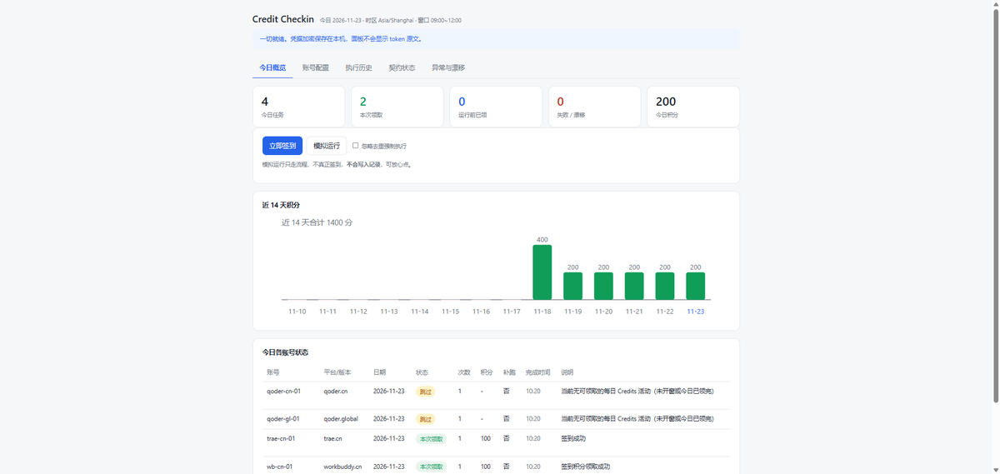

# credit-checkin

一个个人使用的**多平台每日签到领积分**客户端，用一个项目统一管理 **WorkBuddy / Trae / Qoder** 的国内版（`cn`）与国际版（`global`）。

提供 **本地 Web 面板**（浏览器里配置账号、获取凭据、查看状态）和 **命令行** 两种用法。Python 3.9+ 即可运行，**仅依赖标准库，无需 pip install**。

> **定位与免责声明**：本项目是个人学习与自动化实践工具，非商业用途，与腾讯、字节跳动、阿里/通义等厂商无任何隶属或背书关系。签到接口来自社区逆向项目、并非官方 API，请仅用于自己的账号，并自行评估服务条款与账号风控风险。由此产生的账号异常、积分回收等后果由使用者自行承担。

---

## 平台支持

| 平台 / 版本       | 状态    | 说明                                            |
| ------------- | ----- | --------------------------------------------- |
| WorkBuddy 国内版 | ✅ 可用  | `checkin-activity-status` → `daily-checkin`   |
| Trae 国内版      | ✅ 可用  | `checkin_credits/status` → `claim`，需要 16 位设备号 |
| Qoder 国内版     | ✅ 可用  | 活动列表 → `campaigns/{id}/claim`                 |
| Qoder 国际版     | ✅ 可用  | 同上（`openapi.qoder.sh`），需要 PAT 或本机客户端登录态       |
| WorkBuddy 国际版 | ⛔ 已禁用 | 无手动领取入口，每日活跃奖励按使用自动发放                         |
| Trae 国际版      | ⛔ 已禁用 | 没有每日签到活动                                      |

被禁用的版本在代码中强制不执行：即使在配置里手动改成 `enabled: true` 也不会运行，面板会直接拒绝启用并说明原因。

> **Qoder 签到资格**：自 **2026-11-19 10:00** 起，每日领取 100 通用 Credits 仅面向 **Pro 试用期用户**，以及 **Lite / Pro / Pro+ / Ultra 个人付费订阅用户**开放；**体验版（免费）用户不再开放领取**。该活动自 2026-09-18 上线，奖励可在 Qoder 全系产品使用，每笔自领取起 30 天内有效、未到期可跨天保留；调整前已领取的 Credits 不受影响。
>
> 因此如果账号是免费体验版，签到提示"没有可领取活动"属于**平台资格限制**，并非工具故障。若确认账号符合资格仍领不到，再检查本机登录态与设备头；排障细节见 [AGENTS.md](AGENTS.md)。


---

## 特性

- **统一配置**：一个 `config.json` 管住 3 平台 × 2 版本 × N 账号；账号 ID 自动生成，不用手填。
- **凭据不落明文**：支持从本机已登录客户端一键导出 token，用 Windows DPAPI 加密存到本地保险库；页面只显示脱敏值。也可纯手工用环境变量注入。
- **契约驱动适配**：接口地址、鉴权头、响应字段映射都写在 `contracts/*.json`。上游改版时**优先改契约，不用改 Python**。
- **按日幂等**：去重键 = `平台:版本:账号:日期`，当天已成功/已领的账号不会重复领取；当天已有成功记录时，后续重跑不会用"跳过/失败"覆盖它。
- **不漏签**：主时间 + 可配置兜底时间两次触发、关机错过开机补跑、失败自动重试、token 自动续期、并发锁防重入。
- **凭据过期自动恢复**：签到遇到 401 等鉴权失败时，先从本机客户端重新获取凭据（客户端一直登录着就是最新的），再重试签到；本机取不到再用 refresh_token 续期。Qoder 两步都失败时会提示你在弹出的页面做一次设备授权登录，授权后自动重试。
- **契约漂移告警**：响应结构不符或业务码无法识别时记 `drift`、停止重试并告警，绝不误记成功。
- **额度查询**：面板「今日各账号状态」直接显示各平台的剩余积分、总额度、套餐与最近到期时间，只读查询、不消耗积分；国际版无对应接口时不发请求、不报错。
- **可观测**：SQLite 保存签到记录、每次尝试日志和漂移事件；Web 面板提供今日概览、近 14 天积分趋势、历史与异常查询。
- **模拟运行**：不写数据库、不发真实请求，可放心验证流程。
- **数据自洁**：历史数据超过 `retention_days`（默认 180 天）自动清理，日志文件滚动（2MB × 5）。

> **关于"补签"**：平台活动按天结算，过期积分补不回来，所以本项目**不做跨天补签**。漏签保障全部放在"当天"：两次定时触发 + 开机补跑 + 失败重试。

---

## 快速开始

### Windows 小白用户：直接用一个 exe（无需 Python）

如果你只是想用，不想装 Python、不想碰命令行：



1. 从 [最新发布页](https://github.com/tuxinlab/credit-checkin/releases/latest) 下载（页面永远指向最新版，别收藏旧版本链接）

> 每个 Release 有两个附件，内容完全相同：
> - `CreditCheckin-<版本号>.exe` —— 带版本号，**手动下载推荐这个**，一眼看出是哪版（当前最新版是 `CreditCheckin-0.1.9.exe`）
> - `CreditCheckin.exe` —— 固定名，程序内「一键更新」下载用
>
> exe 放到本地后建议改回 `CreditCheckin.exe` 或任意名字均可，数据按用户目录存放，与文件名无关。
2. 把它放到任意文件夹（**建议桌面或自建文件夹，不要放 `C:\Program Files`**）
3. **双击打开**，浏览器会自动弹出操作面板
4. 在面板「账号配置」里添加账号 → 配置凭据 → 点「立即签到」试一次
5. 点「开启每日自动签到」，之后每天自动执行，关掉面板也没关系

首次双击会在**系统用户目录**生成数据（不在 exe 旁边）：

```
%LOCALAPPDATA%\CreditCheckin\
├── config.json      账号与参数配置
├── data\            签到记录、加密凭据（DPAPI 加密）
└── logs\            运行日志
```

完整路径一般为 `C:\Users\你的用户名\AppData\Local\CreditCheckin`。

**exe 放在哪里都不影响数据**——换文件夹、复制多份 exe，读写都是同一份。面板「契约状态 → 当前配置」里能看到实际路径。

整个流程不需要 Python、不需要管理员权限、不写注册表。**卸载**：删掉 exe，再删掉上面那个 `CreditCheckin` 目录即可（如果注册过每日自动签到，先在面板里关掉）。

> 从旧版本升级时，首次启动会自动把 exe 同目录的旧数据**复制**到用户目录（原文件保留，可自行清理）。

> exe 有两套用法：**双击（无参数）= 打开面板**；被系统定时任务以 `--run` 调用 = 静默签到一次。高级用户也可以 `CreditCheckin.exe status` 这样用命令行子命令。

#### 自己构建 exe

需要一台装了 Python 3.9+ 的 Windows 机器（**仅构建时需要 Python，使用 exe 时不需要**）：

```bat
build.bat
```

脚本会自动安装 PyInstaller（如未安装）、把契约和前端内置进 exe，产物在 `dist\CreditCheckin.exe`。把这个 exe 拷给别人就能按上面的小白流程用了。

#### 发布更新与用户的更新体验

更新检查的仓库地址已配置为 `tuxinlab/credit-checkin`（在 `checkin/updater.py` 的 `GITHUB_REPO`）。如果你 fork 了这个项目，记得改成自己的仓库地址，否则会一直提示跟随原仓库的版本。

每次发新版：

1. 改 `checkin/__init__.py` 里的 `__version__`（如 `0.1.9`）
2. 跑 `build.bat` 重新构建（契约和前端内置在 exe 里，改了契约也必须重打包）
3. 在 GitHub Releases 建一个 tag，格式 **`v0.1.9`**（`v` + 版本号），上传**两个**附件并写更新说明：
   - `dist\CreditCheckin.exe` 原名上传（程序内一键更新依赖这个固定名，缺了老版本用户会下载 404）
   - 同一文件另存为 `CreditCheckin-0.1.9.exe` 一起上传（用户手动下载时能区分版本）

用户那边的体验：**打开面板，右上角版本徽章会显示"发现新版本"**，点一下即可下载并自动替换、重启面板，账号配置和签到记录不受影响（数据在用户目录，与 exe 位置无关）。检查失败（没网、限流）会静默降级，不影响签到；点徽章也能手动触发检查。

> 不会后台静默替换：必须用户点徽章确认。下载限定为本仓库的 Releases 地址并校验文件头，替换前备份旧 exe，失败自动回滚。

### 开发者 / 源码运行

下面是拉取源码后的用法。

### 公共准备：拉取代码 + 初始化

配置文件 `config.json` **不在仓库里**（已在 `.gitignore` 排除），所以拉取后第一步必须生成它：

```bash
git clone https://github.com/tuxinlab/credit-checkin.git
cd credit-checkin

python --version                      # 需 3.9+；仅标准库，无需 pip install
python -m checkin init                # 生成 config.json + data/ logs/ 目录
```

`init` 只会创建文件，已存在时不会覆盖（要覆盖加 `--force`）。这一步两种用法都要做，之后二选一。

### 方式 A：Web 面板（推荐，最适合日常使用）

**Windows**：初始化后双击 `start.bat`，脚本会自动探测 Python、启动面板并打开浏览器；关掉窗口即停止。

> `start.bat` 执行 `python -m checkin web --port 8765 --restart`。`--restart` 会自动结束占用端口的旧面板进程，避免浏览器连到旧后端。它**不会替你执行 `init`**，首次使用请先按上面完成初始化。

macOS / Linux 或想手动控制时，用命令行等价操作：

```bash
python -m checkin web                 # 打开 http://127.0.0.1:8765
python -m checkin web --restart       # 端口被旧面板占用时自动结束旧进程
python -m checkin web --port 9000 --no-browser
```

进面板后的顺序：

1. **账号配置 → 添加账号**：选平台和版本、填个备注名即可，账号 ID 自动分配（如 `qoder-gl-01`）。
2. **配置凭据**：WorkBuddy / Trae **国内版**和 Qoder 支持**自动获取本机凭据**（Windows），Qoder 还支持**设备授权登录**（浏览器确认）；也可手动粘贴 token。WorkBuddy / Trae **国际版没有签到活动**，且本机通常只有国内版客户端登录态，自动获取会误绑国内账号，因此面板会拒绝自动获取，请手动填写该国际版账号的 token。
3. **立即签到**（或先点 **模拟运行** 验证流程）。
4. **每日自动签到**：填好时间点，点「开启每日自动签到」注册本机计划任务。

面板只监听 `127.0.0.1`，局域网无法访问；所有接口返回统一脱敏，token 原文绝不回显；页面零外部资源、零第三方依赖。

### 方式 B：纯命令行

完成公共准备后：

```bash
python -m checkin validate            # 1. 校验配置与契约
python -m checkin doctor              # 2. 查看脱敏后的环境与账号概览
python -m checkin probe               # 3. 探测本机客户端凭据 / 环境变量（脱敏）
python -m checkin run --simulate      # 4. 模拟跑通全流程（不发真实请求、不写库）
python -m checkin run                 # 5. 真实签到
python -m checkin status              # 6. 查看今日状态
python -m checkin history --limit 20  # 7. 查看历史
```

真实使用前请先按下面的「凭据」章节让至少一个账号解析到 token。

---

## 凭据

### 解析优先级

1. **环境变量 / 行内凭据**（`credential_env` / `credential`）— 最高优先级
2. **本地保险库**（Web 面板保存，DPAPI 加密，文件为 `data/vault.json`）
3. **本机客户端登录态**（需显式 `--allow-local-decrypt` 或面板的「自动获取本机凭据」）

> 如果某个 `credential_env` 对应的环境变量已设置，它会盖过面板里保存的凭据。想让页面配置生效，请确保对应环境变量为空。

### 自动获取（推荐）

在 Web 面板点「配置凭据 → 自动获取本机凭据」：

- **WorkBuddy**：借客户端自带 Electron 运行时解开加密 envelope；
- **Trae**：解本机 `storage.json` 中的登录态；
- **Qoder**：读本机客户端登录态；本机没登录过时可用「设备授权登录」，在浏览器确认后自动拿到 token。

自动获取时会**同时解析真实绑定账号**（WorkBuddy 昵称、Trae 用户名、Qoder 账号名 + 脱敏手机号），展示在表格的「真实账号（绑定）」列——它和给你自己看的「备注名」是两回事，前者才是签到实际发生的账号。

> 国际版账号如果本机没有对应客户端的登录态，真实账号一栏会留空，不会把国内版账号名冒充成国际版账号；可手动填写 token 后再看。
>
> 自动获取依赖本机客户端已登录，目前主要在 Windows 上可用；解密失败时请改用手动 token。

### 查看积分额度与到期时间

在「今日概览 → 今日各账号状态 → 账号额度与到期」可以看到每个已配置账号的**备注名、真实账号、剩余积分、总额度、套餐名和最近到期时间**，数字与客户端里的账户信息一致（例如 WorkBuddy 显示「1,938 积分、体验版、788 积分 12月17日到期」）。

- 数据来自各平台的账户接口，**只读查询，不消耗积分**，也不会发起签到。
- 结果缓存 5 分钟，点「刷新额度」可立即重新查询；凭据失效或接口暂不可用时，表格里会写明原因（通常是到「账号配置」重新获取一次凭据即可）。
- 没有签到活动的国际版（WorkBuddy / Trae 国际版）额度接口也不可用，表格里显示「未提供活动签到」，不会反复查询或报错。
- 需要该账号的凭据可用；尚未配置凭据的账号显示「未配置」。

> Qoder 国内版与国际版是两个独立账号体系：面板分别读取各自客户端登录态，会显示各自的真实账号名，不会串号。

### 手动环境变量

```powershell
# Windows PowerShell 示例
$env:WORKBUDDY_ACCESS_TOKEN = "..."
$env:TRAE_ACCESS_TOKEN      = "..."   # Cloud-IDE-JWT
$env:QODER_PAT              = "pt-..." # 个人访问令牌
```

常用附加字段：`WORKBUDDY_UID`、`WORKBUDDY_DOMAIN`、`WORKBUDDY_ENDPOINT`、`TRAE_DEVICE_ID`（16 位，缺失会被拒成 9074）、`QODER_EXTRA_HEADERS`（Cosy 设备头 JSON）、`QODER_MACHINE_TOKEN/CODE/TYPE`。完整列表见 [`config/README.md`](config/README.md)。

用 `python -m checkin probe` 查看每个账号实际解析到的来源（脱敏），不会打印 token 内容。日志与历史里的敏感字段会统一替换为 `<redacted>`。

---

## 每日自动签到

### 推荐：面板配置（Windows 计划任务）

在「账号配置 → 每日自动签到」里：

- **每天时间**：主触发时间，默认 `10:20`（Qoder 活动通常 10:00 开窗）。
- **兜底时间**：可选，默认 `15:00`，到点没签成时再试一次；清空则只跑主时间一次。两者都可以在面板里改。
- 点「开启每日自动签到」即注册/更新任务 `CreditCheckinDaily`；「关闭」即卸载任务。面板会显示任务状态、上次运行与下次运行时间。

任务由 Windows 计划任务托管，普通用户权限即可。如果点「开启」时提示 **拒绝访问（0x80070005）**，关闭程序后右键 exe 选「以管理员身份运行」，再点一次「开启每日自动签到」。

### 其他定时方式

- **守护模式（跨平台）**：`python -m checkin schedule --interval-minutes 30`，常驻进程每隔 N 分钟醒一次，但只在 `checkin_window`（默认 09:00–12:00）内执行。
- **PowerShell 脚本**：`powershell -ExecutionPolicy Bypass -File .\scripts\install_windows.ps1`，单触发、每天 10:20，详见 [`scripts/README.md`](scripts/README.md)。
- **crontab（macOS / Linux）**：
  ```cron
  20 10 * * * cd /path/to/credit-checkin && /usr/bin/python3 -m checkin run >> logs/cron.log 2>&1
  ```

### 一次自动签到做了什么

```text
计划任务到点（默认 10:20，兜底 15:00）
  └─ python -m checkin run
       1. 读取 config.json（账号、窗口、重试参数）
       2. 为当天每个启用账号生成任务（去重键 = 平台:版本:账号:日期）
       3. 逐账号执行：
          a. 取凭据（环境变量 → 保险库 → 本机登录态）
          b. 按契约发请求：先查状态，未签则领取；Qoder 先查活动再带 campaignId 领取
          c. 判定结果：本次领取 / 今日已领 / 跳过 / 失败 / 漂移
       4. 写入 SQLite（runs / attempt_logs / drift_events）与日志
       5. 有失败或漂移时按配置推送通知
```

### 容错设计

| 场景            | 机制                                                 |                             |
| ------------- | -------------------------------------------------- | --------------------------- |
| 到点时电脑关机 / 睡眠  | 计划任务开启 `StartWhenAvailable`，恢复可用后补跑（只在当天窗口内有效，不跨天） |                             |
| 使用电池          | 允许电池供电时启动、切电池不中断                                   |                             |
| 执行中途异常退出      | 任务带 `RestartCount=2`；僵死的 `running` 记录 10 分钟后允许重跑   |                             |
| 连续多天没开机       | 那几天的积分已过期无法补领；从下次开机起恢复正常，当天仍有兜底触发                  |                             |
| 网络抖动 / 临时 5xx | 指数退避重试（默认 60s / 300s / 900s）                       |                             |
| 凭据失效（401）     | 先从本机客户端自动重新获取凭据再重试；取不到再用 refresh_token 续期；Qoder 仍失败会提示页面授权登录 |                             |
| 接口改版          | 结构或业务码不匹配 → 记 `drift` + 告警，不重试、不误记成功               |                             |
| 一天跑多次 / 重复触发  | 去重键命中终态直接跳过；已有成功记录不会被后来的"跳过/失败"覆盖                  |                             |
| 怎么确认它真的跑了     | 每次启动都写日志（\`run 启动                                  | 日期 …\`）；面板显示上次运行、结果码与下次运行时间 |

> 计划任务默认以「当前用户、仅在登录时」运行（`InteractiveToken`）。如果经常注销，建议改用 `schedule` 守护模式，或把任务改为"不管用户是否登录都运行"并保存密码。

---

## Web 面板功能

| 标签页       | 内容                                                                          |
| --------- | --------------------------------------------------------------------------- |
| **今日概览**  | 近 14 天积分趋势，各账号当日状态与积分额度/到期；「立即签到」「模拟运行」按钮         |
| **账号配置**  | 增删改账号、启停、配置凭据（自动获取 / 设备授权 / 手动）、查看真实绑定账号；每日自动签到设置；本机登录态探测；签到窗口与时区等高级参数（折叠区） |
| **执行历史**  | 按状态、平台过滤，查看积分与耗时                                                            |
| **契约状态**  | 已加载契约清单与当前配置                                                                |
| **异常与漂移** | 漂移事件列表，可展开已脱敏的响应样本，指导契约更新                                                   |

模拟运行只走流程、不写记录，页面上有明确提示。

---

## 命令参考

| 命令                                                                                                    | 作用                   |
| ----------------------------------------------------------------------------------------------------- | -------------------- |
| `init [--force]`                                                                                      | 生成配置模板               |
| `validate`                                                                                            | 校验配置与所有契约            |
| `doctor`                                                                                              | 脱敏环境与账号概览            |
| `plan [--date] [--platform] [--version] [--account-id]`                                               | 查看当天签到计划             |
| `run [--date] [--platform] [--version] [--account-id] [--simulate] [--force] [--allow-local-decrypt]` | 执行签到（默认跳过已完成任务）      |
| `status [--date]`                                                                                     | 某日执行状态               |
| `history [--limit] [--platform] [--status] [--account-id]`                                            | 历史记录                 |
| `errors [--limit]`                                                                                    | 失败记录与最近尝试日志          |
| `drifts [--limit]`                                                                                    | 契约漂移事件（需人工介入的信号）     |
| `contracts`                                                                                           | 已加载契约清单              |
| `probe [--allow-local-decrypt]`                                                                       | 探测本机客户端凭据与环境变量状态（脱敏） |
| `web [--port] [--no-browser] [--restart] [--simulate]`                                                | 启动本地 Web 面板          |
| `schedule [--interval-minutes] [--simulate] [--allow-local-decrypt]`                                  | 守护模式：仅在签到窗口内执行       |

全局参数 `--config <path>` 可指定配置文件；环境变量 `CHECKIN_HOME` 可指定项目根目录（影响凭据库与数据目录位置）。

---

## 目录结构

```text
credit-checkin/
├── README.md                   本文件
├── config.json                 你的配置（init 生成，已加入 .gitignore，请勿提交）
├── main.py                     PyInstaller 打包入口（源码运行用不到）
├── checkin/
│   ├── __main__.py             程序入口：源码走 CLI，exe 走双模式
│   ├── paths.py                路径层：内置资源 / 固定数据目录 / 旧数据迁移
│   ├── cli.py / config.py      命令行 / 配置加载与校验
│   ├── models.py / storage.py  数据模型 / SQLite 存储
│   ├── plan.py / executor.py   每日计划 / 重试与落库
│   ├── credentials.py          凭据提供器（环境变量 / 保险库 / 本机登录态）
│   ├── vault.py                凭据保险库（Windows DPAPI 加密）
│   ├── manage.py               账号 / 凭据 / 定时任务管理
│   ├── autofill*.py            三平台本机凭据自动获取与 Qoder 设备授权
│   ├── refresher.py            token 自动续期
│   ├── notifier.py / utils.py  通知 / 时区与脱敏
│   ├── updater.py              版本检查与一键替换
│   ├── web.py                  本地 Web 面板后端（仅 127.0.0.1）
│   └── adapters/               契约解析、HTTP 适配器、注册表
├── contracts/                  6 个真实接口契约（含来源标注与漂移规则）
├── web/index.html              Web 面板单文件前端
├── config/README.md            配置项详解
├── contracts/README.md         契约格式与漂移处理指南
├── scripts/                    Windows 计划任务安装脚本
├── tests/                      unittest 测试（含真实响应样本与 Web API）
├── images/                     README 截图
├── build.bat                   一键构建单文件 exe（PyInstaller）
├── start.bat                   源码模式下双击启动面板
├── dist/                       PyInstaller 构建产物（.gitignore，发版附件从这个目录取）
├── data/                       源码模式的数据库与凭据库（.gitignore）
└── logs/                       运行日志（.gitignore）
                                  （exe 模式下 data/ logs/ 位于 %LOCALAPPDATA%\CreditCheckin）
```


---

## 扩展新平台

1. 在 `contracts/` 增加 `<platform>.<version>.json`，格式见 [`contracts/README.md`](contracts/README.md)。
2. 在 `config.json` 的 `platforms` 下添加账号；如果是全新平台名，同步在 `checkin/models.py` 的 `Platform` 枚举中登记。
3. 运行 `python -m checkin validate` 确认契约被加载，再用 `run --simulate` 验证流程。

若某平台鉴权需要多步（如 refreshToken 换 accessToken），可在 `steps` 中加一步并用 `${token}` / `${var.*}` 占位符串联；复杂场景可在 `adapters/` 中新增专用适配器并在 `registry.get()` 中分发。

接口改版的排查流程：面板「异常与漂移」或 `python -m checkin drifts` 查看响应样本 → 更新契约的 `steps` / `verdicts` / `capture` → 递增 `contract_version` → `validate` 与 `run --simulate` 验证。

---

## 安全说明

- 仓库**不含任何凭据**；`config.json`、`data/`、`logs/` 均已在 `.gitignore` 中排除。
- 面板保存的 token 用 **Windows DPAPI** 加密，只有当前用户能解密；环境变量优先级高于面板配置。
- 日志、历史、漂移样本、Webhook 与所有 API 返回都统一脱敏（token / pat / cookie / authorization 等替换为 `<redacted>`）。
- Web 面板只监听 `127.0.0.1`；静态页面零外部资源、零第三方依赖。
- 不要伪造设备标识或绕过平台风控；同一账号的 refreshToken 轮换链不要在多个工具中同时刷新。

---

## 测试

```bash
python -m unittest discover -s tests -v
```

当前 166 个测试全部通过，覆盖契约解析与判定规则、HTTP 状态码防护、计划去重、执行器重试/漂移/令牌续期、并发写锁、凭据自动获取、额度查询、Web API、定时任务注册与真实响应样本。

---

## 参考项目

本项目为独立实现，架构设计参考了以下社区项目（按其各自许可证）：  
`88lin/workbuddy-auto-signin`、`liubinne/workbuddy-free-credits`、`crush1994/Trae-AutoCheckin`、`luoleiyong/TraeAutoCheckin`、`L0NE-6/Qoder-Daily`、`spirodelazz/ide-daily-checkin`。

## 许可证

MIT，详见 [LICENSE](LICENSE)。附加条款：仅限个人学习与自动化实践使用，使用本工具可能违反相关服务条款，由此产生的后果由使用者自行承担。
